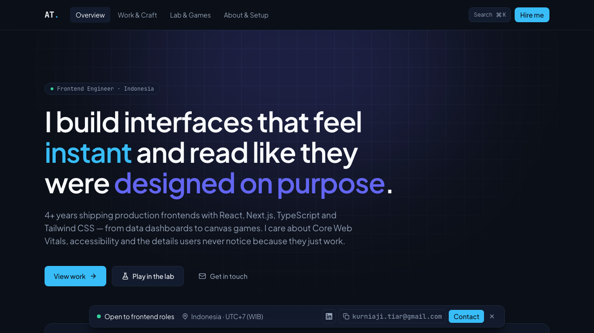
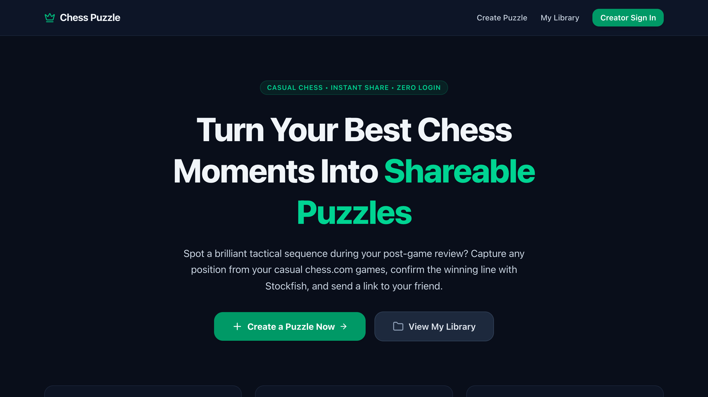
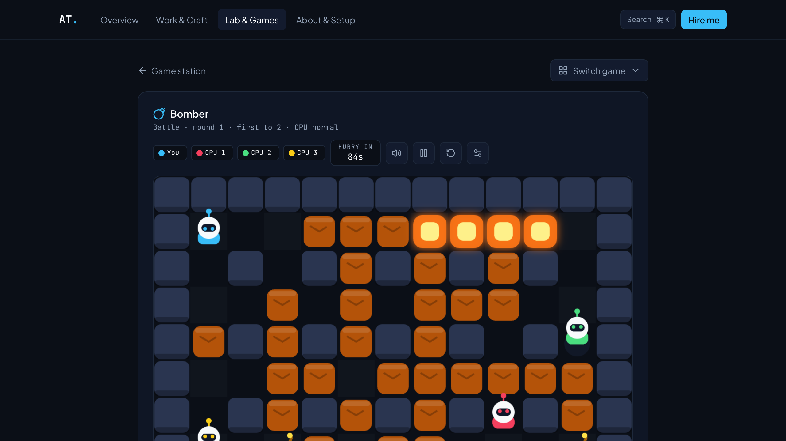
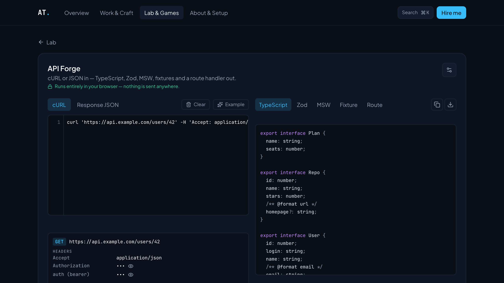
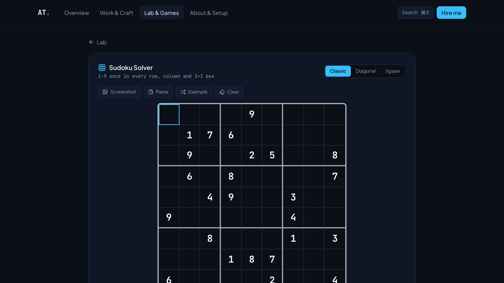

# Hi, I'm Ahmad Tiar Kurniaji 👋

**Frontend Engineer** · Indonesia (UTC+7) · Open to frontend roles

I build fast, accessible web apps with React, Next.js and TypeScript —
and occasionally a puzzle solver or a canvas game for fun.

> 🔭 **Currently:** leading the frontend on a contract engagement, building puzzle tools in [the Lab](https://ahmad-tiar.vercel.app/lab), and open to frontend roles.

---

### 🧭 About me

- 💼 **2026 — now:** Frontend-focused full-stack engineer (contract & freelance) — leading the frontend and handling parts of the backend.
- 🏢 **2022 — 2026:** Frontend Engineer at PT. Qoin Digital Indonesia — front-end development on a full-time product team for close to four years.
  <!-- TODO: add 1–2 concrete things you shipped or owned at Qoin -->
- 🎓 Alterra Academy Front-End Bootcamp · B.Ed. English Education, UIN Raden Mas Said Surakarta

**How I work**

- ⚡ **Performance is a feature** — ship less JavaScript, measure Core Web Vitals instead of guessing.
- 🗂️ **State has one home** — server state in a query cache, UI state close to where it's used.
- ♿ **Accessible by default** — keyboard paths, focus rings and reduced motion from the first commit.

### 🛠️ Stack

### 🚀 Featured work

<table>
  <tr>
    <td width="50%" valign="top">
      
      <h4><a href="https://github.com/ATiarK/chess-puzzle">Chess Puzzle Studio</a> · <a href="https://chess-puzzle-mu.vercel.app">live</a></h4>
      Create tactical puzzles from a PGN or a hand-set board, verify them with Stockfish, and share a link anyone can solve without signing up.
       Next.js 16 · Stockfish WASM · Drizzle · Neon · Clerk
    </td>
    <td width="50%" valign="top">
      
      <h4><a href="https://ahmad-tiar.vercel.app/lab/bomber">Bomber</a></h4>
      Grid bomb battles against CPUs or a friend, plus an adventure mode. The CPU AI reads a danger map, commits to escape routes and sets traps.
       TypeScript · Canvas 2D · game AI
    </td>
  </tr>
  <tr>
    <td width="50%" valign="top">
      
      <h4><a href="https://ahmad-tiar.vercel.app/lab/tools/apiforge">API Forge</a></h4>
      Paste a cURL or JSON response and get TypeScript types, a Zod schema, MSW mocks and fixtures. Runs entirely in the browser.
       TypeScript · Web Worker · code generation
    </td>
    <td width="50%" valign="top">
      
      <h4><a href="https://ahmad-tiar.vercel.app/lab/tools/sudoku">Sudoku Solver</a></h4>
      Classic, Diagonal and Jigsaw Sudoku with hints that explain the logic. Import a screenshot and the grid and variant are detected.
       TypeScript · Web Worker · digit recognition
    </td>
  </tr>
</table>

### 🎮 The Lab

My [portfolio](https://ahmad-tiar.vercel.app/lab) doubles as a playground — every engine hand-written in TypeScript, no game libraries.

| Try it | What's inside |
| --- | --- |
| 🧱 [Tetris](https://ahmad-tiar.vercel.app/lab/tetris) | SRS kicks, 7-bag, hold, T-spins, back-to-back & combos |
| 🧩 [Klotski](https://ahmad-tiar.vercel.app/lab/klotski) | 4×5 sliding blocks with a BFS solver that computes par for every level |
| 🎯 [Karambol](https://ahmad-tiar.vercel.app/lab/carrom) | Carrom disc physics, official singles rules, simulation-search CPU |
| 🃏 [Solitaire](https://ahmad-tiar.vercel.app/lab/solitaire) | Klondike with seeded deals, hints and auto-finish |
| 📦 [Sokoban](https://ahmad-tiar.vercel.app/lab/sokoban) | Deadlock detection, click-to-walk, original solver-verified levels |

…plus 15 more games, puzzle solvers for LinkedIn's **Zip** and **Queens** (with screenshot import), and dev tools — JSON diff, JWT decoder, regex tester, color converter — that all run locally in your browser.

Portfolio built with Next.js 16 · React 19 · TypeScript strict · Tailwind CSS 4 · Framer Motion — fully static, deployed on Vercel.

### 📊 GitHub stats

